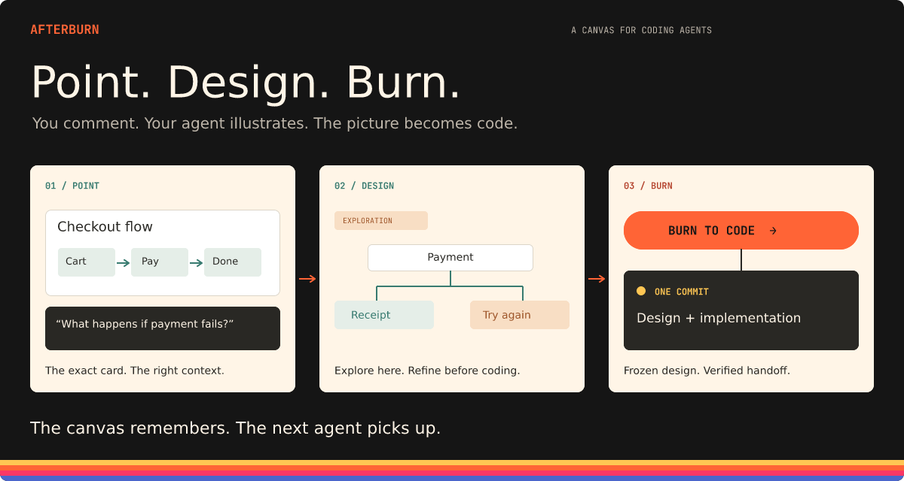
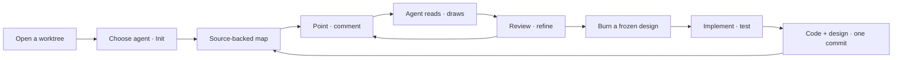
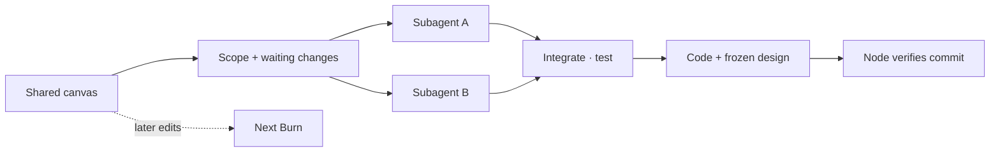
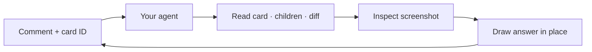

<h1 align="center">Afterburn</h1>

<p align="center"><strong>The canvas for coding agents.</strong><br />Point at the product. Refine the picture. Burn it into code.</p>

<p align="center">
  <a href="#get-started">Get started</a> ·
  <a href="#the-loop">The loop</a> ·
  <a href="#give-your-agent-a-shared-picture">Agent tools</a> ·
  <a href="#under-the-hood">Under the hood</a>
</p>



Software work is wider than a chat thread: plans, designs, decisions, screenshots, and several agents at once. Afterburn gives that work a place on a canvas that lives with your repository.

**You comment. Your agent illustrates.** Ask about a flow, point out a bug, or explore a new screen. The agent reads the code and answers on the canvas with diagrams, designs, images, or video. Keep refining the idea there; when you're ready to implement it, **Burn** turns the waiting design into a coding task.

## The loop



Sources: [service/src/node_context.rs:33](service/src/node_context.rs#L33) · [service/src/node_brief.rs:78](service/src/node_brief.rs#L78) · [service/src/node_git.rs:1050](service/src/node_git.rs#L1050).

| Your intent | Agent's result | When it is recorded |
|---|---|---|
| Explain what exists | Diagram with code references | Explanation commit |
| Fix a bug | Checked implementation + corrected map | Fix commit |
| Explore an idea | A proposal on the canvas | Waits for Burn |

You can keep designing during a Burn. Later edits wait for the next one. [Workflow contract →](skills/afterburn/SKILL.md)

## Why a canvas?

| | What changes |
|---|---|
| **Point, don't describe** | A comment belongs to an exact card. No “the third box under that arrow.” |
| **Work asynchronously** | Leave a task with an agent, work elsewhere, and come back to the result in place. |
| **Keep the context** | Decisions and designs have a location. The map is a versioned file in your repo. |
| **Pages, not folders** | Organize the product by concepts and flows; open a subpage when a card needs more detail. |
| **Switch agents** | The next agent can read the same cards, pictures, and pending changes. |

### Know what's real and what's next

**State of the art** pages describe the code as it is. **Exploration** pages hold ideas that haven't been built yet. A completed Burn moves the exploration into the state of the art.

That distinction lets you design ahead without presenting every idea as a shipped feature. Source references keep explanations traceable to the implementation. The map still needs review and maintenance as the code changes.

### Design continuously. Burn in parallel.

The next agent can fetch the same cards, pictures, and pending changes. For a large Burn, the agent can split independent work across subagents, then integrate and verify it.



Sources: [service/src/node_brief.rs:94](service/src/node_brief.rs#L94) · [service/src/node_brief.rs:125](service/src/node_brief.rs#L125) · [service/src/node_git.rs:1050](service/src/node_git.rs#L1050).

The node checks the branch, ancestry, frozen design, and job trailer. Tests and review establish whether the implementation is correct.

## Give your agent a shared picture

Every box has an ID. Point once; the agent pulls the context it needs through the Afterburn **MCP server**.



Sources: [service/src/comments.rs:275](service/src/comments.rs#L275) · [service/src/node_main.rs:185](service/src/node_main.rs#L185).

<details>
<summary><strong>The tools behind the canvas</strong></summary>

| Read | Write |
|---|---|
| `get_node` — a card or page and its children | `create_node` — add a layer |
| `screenshot` — see the current design | `set_properties` — update specific layers |
| `inspect_document` — inspect the map | `run_command` — execute a document command |
| `node_request` — inspect diffs and job state | `add_video` — place a clip on the canvas |

`list_commands` exposes the document commands and their parameters. The node owns the live design and saves `.afterburn/map.figcraft`.

For a manually configured MCP client:

```sh
afterburn-node mcp --path /absolute/path/to/your/repo
```

Init sets up the Afterburn skill and MCP entry for installed **Claude Code** and **Codex** CLIs. Agents run in the machine's shared **Herdr** workspace; other supported runners need their own tool configuration. [Tool setup →](service/src/agent_tools.rs)

</details>

## Get started

Afterburn is early software. The packaged desktop workflow is **macOS**; the headless node can run on **macOS or Linux**. Bring Git, Herdr, and an installed coding-agent CLI such as Claude Code or Codex, configured for your account.

### Build and open the Mac app

From a checkout of this repository, with Rust **1.97.1**, Xcode command-line tools, and Python **3.9+** installed:

```sh
./client/build-mac.sh
open "$HOME/Applications/Afterburn.app" --args --map-mode --node 127.0.0.1:47822
```

The script builds the app and node together, installs `Afterburn.app`, and registers a separate launchd helper. The node keeps running when you quit the app.

Open your repository's worktree, choose an agent, and press **Init** to draw your first map. If Herdr is missing, host setup asks before installing it. Existing nodes from a different build require an explicit upgrade.

[Full Mac setup and upgrades →](client/README.md)

### Run a headless node

Build and run on the machine that holds your repository:

```sh
cargo build --release --locked -p afterburn-node
./target/release/afterburn-node serve --bind 127.0.0.1:47822
```

The listener is local to that machine. Connect the desktop app to a remote node through SSH; each worktree and branch has its own session.

[Remote machines, service installation, and protocol →](service/NODE.md)

## Under the hood

Afterburn is a Rust desktop app built on **FigCraft's engine and egui canvas**, backed by a node on each repository machine. Herdr runs the agents. Git stores the design alongside the code.

| Area | Where to look |
|---|---|
| Desktop app and canvas | [server/figcraft/](server/figcraft/) |
| Node, agent routing, and verified commits | [service/](service/) |
| Mac packaging and deployment | [client/](client/) |
| How agents work with the map | [Afterburn skill](skills/afterburn/SKILL.md) |
| Website | [landing/](landing/) |
| Historical feature-map generator | [design/](design/README.md) |

<details>
<summary>Follow the implementation</summary>

- [Comment → exact card](service/src/comments.rs#L275) and [page-scoped context](service/src/node_context.rs#L1)
- [MCP tools](service/src/node_main.rs#L185) and [agent tool setup](service/src/agent_tools.rs#L131)
- [Pages and exploration mode](server/figcraft/crates/ui-egui/src/page_tree.rs#L1)
- [The implementation brief and parallel work](service/src/node_brief.rs#L78)
- [Frozen-design commit verification](service/src/node_git.rs#L1050)

</details>
